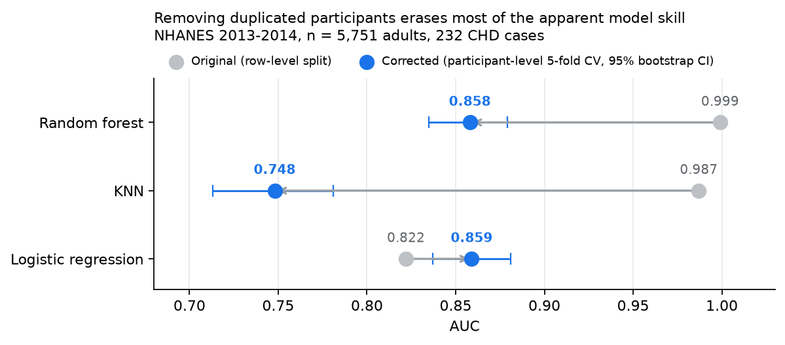
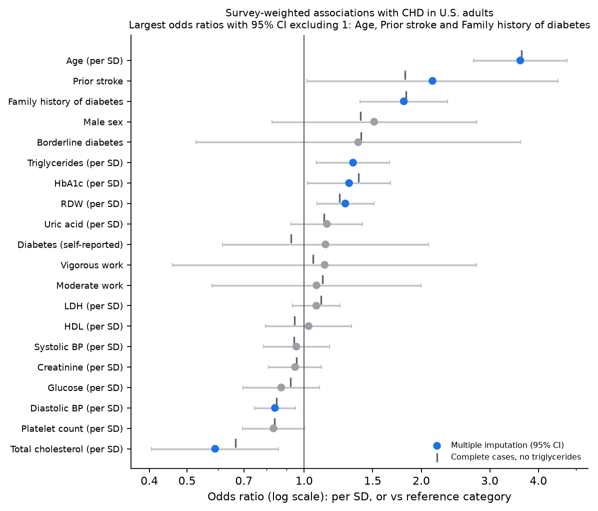

# Coronary Heart Disease on NHANES 2013-2014: Data Audit and Model Revalidation

A replication of a published CHD-prediction model on CDC NHANES data that turned into a data-leakage audit. The original pipeline reported random-forest AUC 0.999; after fixing a one-to-many join and evaluating at the participant level, the honest number is 0.86, and plain logistic regression does just as well.



## Key findings

| | Original pipeline | After audit |
|---|---|---|
| Analysis rows | 15,103 "participants" | **5,751 participants** (232 CHD, 4.0%) |
| Cause | `medications.csv` has one row per prescription; an outer join on `SEQN` repeated each person 1-23 times | Collapse medications to one row per person before joining; assert uniqueness |
| Train/test split | Row-level: 75% of test rows (98% of CHD test rows) had an exact copy in the SMOTE training set | Participant-level stratified 5-fold CV, imputation and scaling fit inside each fold |
| Random forest AUC | 0.999 | **0.858** (95% CI 0.835–0.879) |
| KNN AUC | 0.987 | **0.748** (0.713–0.781) |
| Logistic regression AUC | 0.822 | **0.859** (0.837–0.881) — ties RF; paired bootstrap difference +0.001 (−0.011 to +0.012) |
| Accuracy as a metric | 0.996 (random forest) looked great | Misleading at 4% prevalence: RF reaches 0.948 accuracy while finding 15.5% of cases |

Screening operating point (logistic regression, 5-fold out-of-fold): at a 0.40 threshold the model catches **86% of CHD cases at 72% specificity**, flagging 31% of adults (PPV 0.11). SMOTE applied correctly, inside each training fold, gives the same AUC as class weighting (0.856 vs 0.859 for LR; 0.840 vs 0.858 for RF) — the original 0.999 came from leakage, not from SMOTE.

### Biostatistical extensions

| Question | Method | Result |
|---|---|---|
| Are the predicted risks believable? | Decile calibration curve, calibration slope, Brier score | Class weighting inflates mean predicted risk to 30% (observed 4%). The **unweighted** LR is calibrated: 4.05% vs 4.03%, slope 0.94, Brier 0.035 (no-skill 0.039) |
| Is the model worth using? | Decision curve analysis | Calibrated LR beats treat-all and treat-none at every threshold 1–30%; the class-weighted model does worse than treating no one above 5% |
| Does missing-data handling matter? | Mean, missing indicators, MICE, drop triglycerides, complete cases (all inside folds) | AUC 0.857–0.860 throughout; triglycerides are missing by design (fasting subsample) |
| What is the U.S. prevalence? | Survey weights (`WTMEC2YR`), 15 strata × 2 PSUs, domain estimation, Taylor linearization, logit CIs; verified against a stratified jackknife | **3.6% (95% CI 2.8–4.7%) ≈ 8.3 million adults**; 10.7% at 60+, 11.6% with diabetes, 19.4% after a stroke; design effects ≈ 2–3 |
| Which factors are associated with CHD in the population? | Survey-weighted logistic regression (design-based sandwich SEs, the `svyglm` estimator) with multiple imputation (m = 20, Rubin's rules, Barnard-Rubin df); SEs verified against a 30-replicate jackknife | Age OR 3.59 per SD (2.72–4.74), family history of diabetes 1.80 (1.39–2.34), HbA1c 1.30/SD, RDW 1.28/SD; total cholesterol 0.59/SD (0.41–0.86), an inverse association consistent with statin treatment after diagnosis |



**Cross-check against R `survey`** (`analysis/svy_logistic.R`, optional):

| Quantity | R `survey` vs Python | Notes |
|---|---|---|
| Weighted prevalence, 18 groups (`svyciprop`, logit CI) | max difference in estimate / SE / CI: 0.00004 / 0.00005 / 0.00005 | same estimator; differences are rounding |
| Adjusted ORs, complete cases (`svyglm`) | max difference 0.0005 in OR and CI bounds | confirms the Python sandwich-variance implementation |
| Adjusted ORs, multiple imputation (m = 20) | point estimates within 0.05 for 19 of 20 terms; every term has the same significance conclusion | imputation models differ (`mice` pmm/logreg vs `IterativeImputer`). Self-reported diabetes differs most (1.03 vs 1.13): it is collinear with HbA1c and glucose, whose imputations differ, and its CI is wide (≈0.5–2.1) |

Methods are written up TRIPOD-style in [`docs/TRIPOD_methods.md`](docs/TRIPOD_methods.md).

Other corrections: the feature labeled "blood-relative stroke" was actually `MCQ160F`, the participant's own stroke history; the decision threshold is now chosen for screening sensitivity instead of defaulting to 0.5; SMOTE, when used, is applied inside each fold.

## Repository layout

```
notebooks/
  data_preprocessing.ipynb                 v2 pipeline: one row per participant (fixed join, relabeled stroke variable)
  nhanes_chd_audit_and_revalidation.ipynb  audit, leakage check, corrected CV, bootstrap CIs, thresholds,
                                           SMOTE-in-fold vs class weights, odds ratios, calibration, decision curve,
                                           missing-data sensitivity, survey-weighted prevalence and logistic regression;
                                           exports Power BI tables
  preprocessing_v1_original.ipynb          the original preprocessing (one-to-many join), kept to show where the duplicates came from
  baseline_v1_original.ipynb               the original modeling notebook, kept as the "before" for the audit
analysis/
  svy_logistic.R                           optional: re-runs sections 12-13 in R `survey` as an independent cross-check
data/            raw NHANES files (git-ignored) and the v1 artifacts the audit reproduces   -> data/README.md
outputs/         analytic tables (CSV) consumed by Power BI, written by the audit notebook
powerbi/         POWERBI_GUIDE.md (page layouts, visual specs), measures.dax, theme.json
docs/            TRIPOD methods, figures
```

## Data

[NHANES 2013-2014](https://wwwn.cdc.gov/nchs/nhanes/continuousnhanes/default.aspx?BeginYear=2013) (CDC National Center for Health Statistics), six public-use files joined on participant ID `SEQN`: demographics, diet, examination, laboratory, medications, questionnaire. Outcome: `MCQ160C`, "Has a doctor ever told you that you had coronary heart disease" (adults 20+). Features: the 19 variables of the replicated paper (sex, age, systolic/diastolic BP, total cholesterol, HDL, triglycerides, glucose, HbA1c, creatinine, uric acid, LDH, platelet count, RDW, vigorous/moderate work, diabetes, family history of diabetes, stroke history).

Download the six CSVs into `data/raw/`. The analysis uses the Kaggle mirror "National Health and Nutrition Examination Survey", which repackages the official CDC files ([NHANES 2013-2014 data, documentation and codebooks](https://wwwn.cdc.gov/nchs/nhanes/continuousnhanes/default.aspx?BeginYear=2013)).

## Reproduce

```bash
pip install -r requirements.txt
jupyter nbconvert --to notebook --execute notebooks/data_preprocessing.ipynb            # -> data/processed/
jupyter nbconvert --to notebook --execute notebooks/nhanes_chd_audit_and_revalidation.ipynb  # -> outputs/*.csv
Rscript analysis/svy_logistic.R      # optional cross-check; needs install.packages(c("survey", "mice", "mitools"))
```

The audit notebook reads the v1 artifacts (`data/selected_features_v1.csv`, `data/train_split_smote.csv`, `data/test_split.csv`, included) so the before/after comparison is reproducible; see `data/README.md`. Both notebooks are committed with their executed outputs.

## Power BI dashboard

Planned three-page report built from `outputs/`: (1) cohort and CHD prevalence by clinical risk group with sex/age slicers and a weighted/unweighted toggle; (2) the audit story — rows-to-participants funnel, leakage share, AUC before vs after with bootstrap error bars, an interactive decision-threshold explorer, and odds ratios; (3) U.S. population estimates with design-based CIs, calibration plot, decision curve and the missing-data sensitivity table. Build instructions, DAX measures and the theme are in [`powerbi/`](powerbi/POWERBI_GUIDE.md).

## Methods summary

- Preprocessing: mean/mode imputation, one-hot encoding, z-scoring, all fit inside each CV fold.
- Evaluation: stratified 5-fold cross-validation at the participant level; AUC with 1,000-sample bootstrap 95% CI; sensitivity/specificity at a chosen threshold.
- Class imbalance: `class_weight="balanced"` (LR, RF) compared with SMOTE applied inside each training fold; KNN thresholded at the outcome rate.
- Calibration and usefulness: decile calibration curve, calibration slope, Brier score, decision curve analysis.
- Missing data: five strategies compared inside folds; multiple imputation with Rubin's rules for the survey-weighted model.
- Population inference: NHANES exam weights, strata and PSUs; domain estimation; Taylor-linearized SEs for prevalence and sandwich SEs for the weighted logistic regression, both checked against a stratified jackknife.
- Interpretation: odds ratios per SD from the unweighted prediction model (bootstrap CIs) and from the survey-weighted model (design-based CIs, multiple imputation).

## Limitations

- Cross-sectional, self-reported outcome: labs were measured after diagnosis, so treatment effects (e.g. statins lowering cholesterol) can reverse apparent associations.
- Internal validation only; a later NHANES cycle (2015-2016, 2017-2020) would be the natural external test set.
- The paper's PSO-ANN was not re-implemented; its reported 0.97 accuracy is not comparable to AUC at 4% prevalence.

## Author

Ziang Zhang. This began as a team project for BIOL 485 at Emory University: I wrote the data pipeline and baseline models (v1), and teammates contributed later testing. The audit, revalidation, survey-weighted analysis and Power BI report were done independently after the course.

## Acknowledgments

I thank Dr. Gordon Berman (instructor) and Xinlin G. (teaching assistant) for their guidance on the original course project, and my teammates Varun V., Jason L. and Alison L. for testing the original pipeline. Any errors in the later work are mine.
